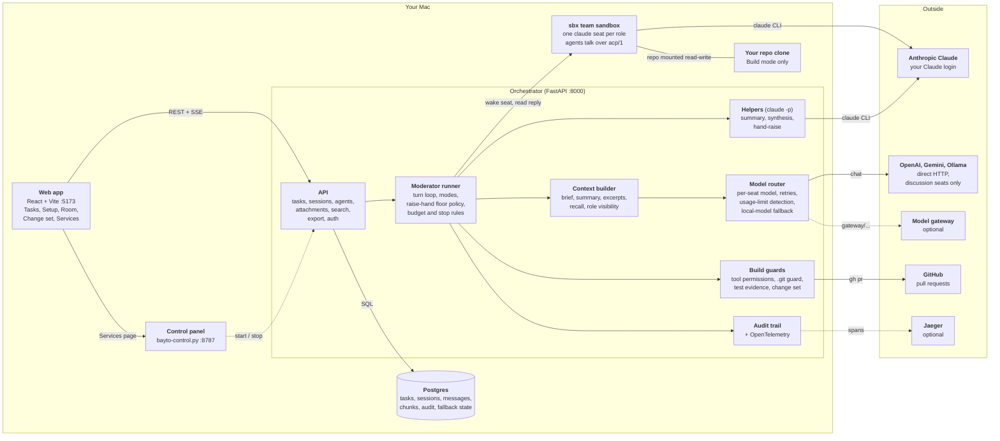
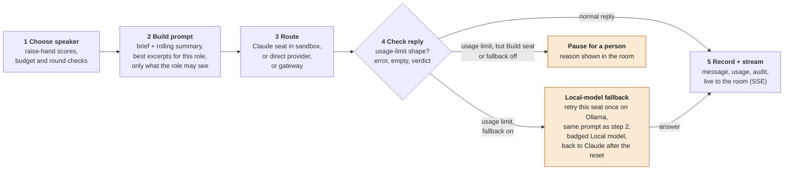
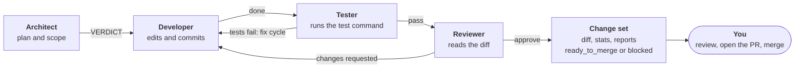

# Bayto architecture

Several AI agents take turns on one task. A web page talks to one orchestrator. The orchestrator decides who speaks, builds each agent's prompt, sends the turn to a model, and records everything in Postgres. Local first, no accounts, your own Claude login.

The diagrams are Mermaid, so GitHub draws them in the page. Keep them in step with the code when components change.

## 1. What runs where

The browser never talks to a model. Every turn goes web app → orchestrator → a model, and every result is written to Postgres before it is streamed back. Discussion seats can use other providers; Build seats run only in the sandbox.

## 2. One turn, including the usage-limit path

The prompt is built once and reused, so a fallback seat sees the same context Claude would have. The fallback path exists only when the task opts in. Otherwise a usage limit pauses the session instead of changing the model quietly.

Build seats never fall back: they need tools and history that a local model path does not have.

## 3. Build mode: from brief to pull request

Each role ends with a `VERDICT:` line that routes the next step. Fix cycles are bounded, and anything unroutable stops the session for a person instead of looping.

Guards that apply throughout:

- **Before any host git command**, `.git` config and hooks are restored from the session baseline, so an agent cannot plant a hook that runs on your machine.
- **A pass needs evidence**: a test command and exit code 0. A missing `VERDICT:` pauses the run.
- **No push, no network, one running session per task.** The repo must be clean to start, and it stays on the build branch afterwards.

## Design choices worth knowing

- **Local first, no accounts.** One orchestrator, one Postgres, your own Claude login. Sign-in is an optional shared token (`BAYTO_API_TOKEN`) for when the port is reachable by others; put TLS in front in that case.
- **Context is chosen per seat.** Each seat gets the excerpts most relevant to its role and the current question, filtered by who may see each attachment, within a fixed budget.
- **Everything is recorded.** Messages, usage, stop reasons, fallbacks and exports are stored and audited, so a session can be exported as a decision record.
- **Changes need a person.** Build never pushes or merges. Its output is a branch, a change set and a pull request that you open.

See also: [product design](product-design.md), [Build mode design](build-mode-design.md), [per-agent models](per-agent-models.md), [per-agent context](per-agent-context-rag.md), [audit trail](audit-trail.md).
