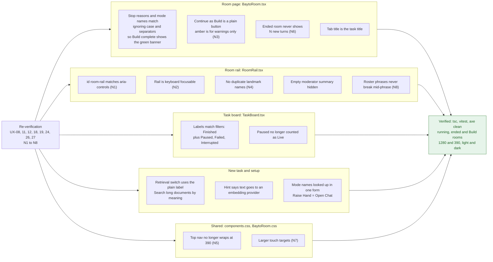
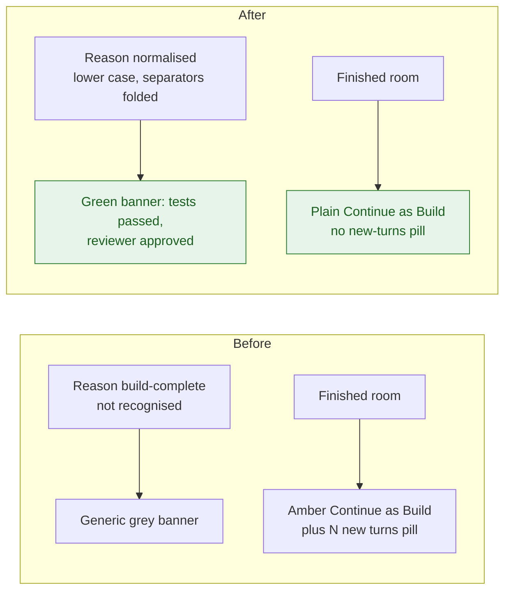

# UX round 2 (PR #211)

What PR #211 changed, grouped by page. Findings come from `docs/ux-reverify-2026-10-23.md`; `UX-xx` were "Partly fixed" after round 1, `N1`-`N8` were new in the re-check.

## Findings by page

## Finished room before and after

## Files touched

`web/src/pages/`: `BaytoRoom`, `TaskBoard`, `NewTaskForm`, `SessionSetup` (+ tests, `BaytoRoom.css`).
`web/src/components/`: `RoomRail` (+ css, test). `web/src/components.css`, `web/src/api/tasks.ts`, `docs/decisions.md`.
